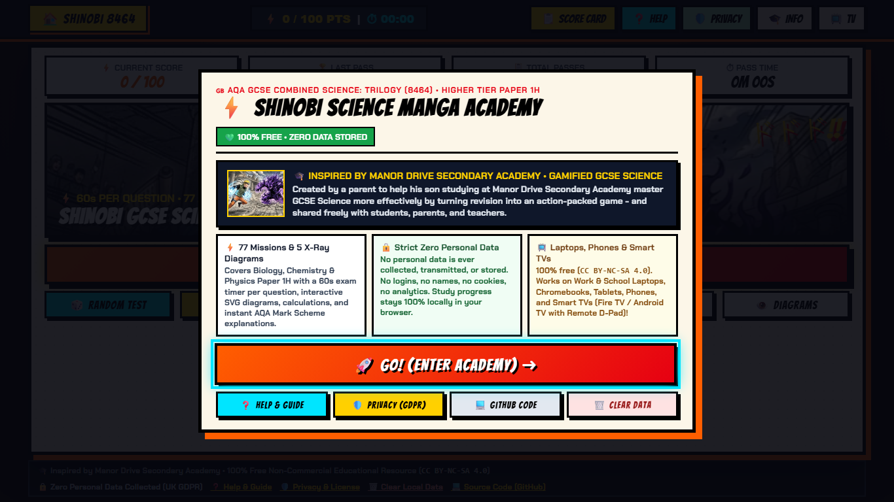
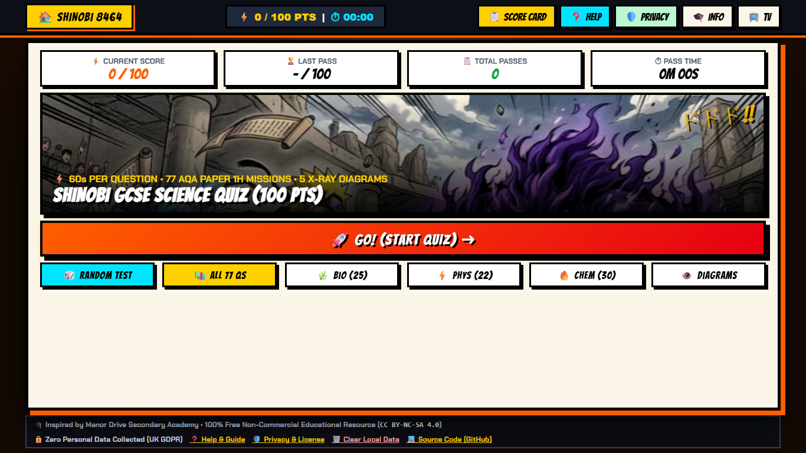
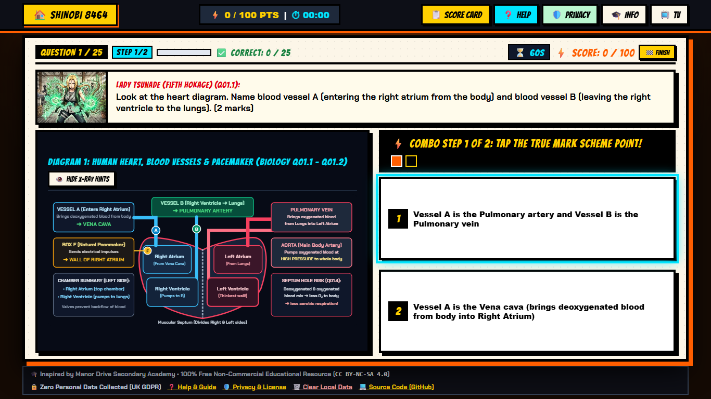
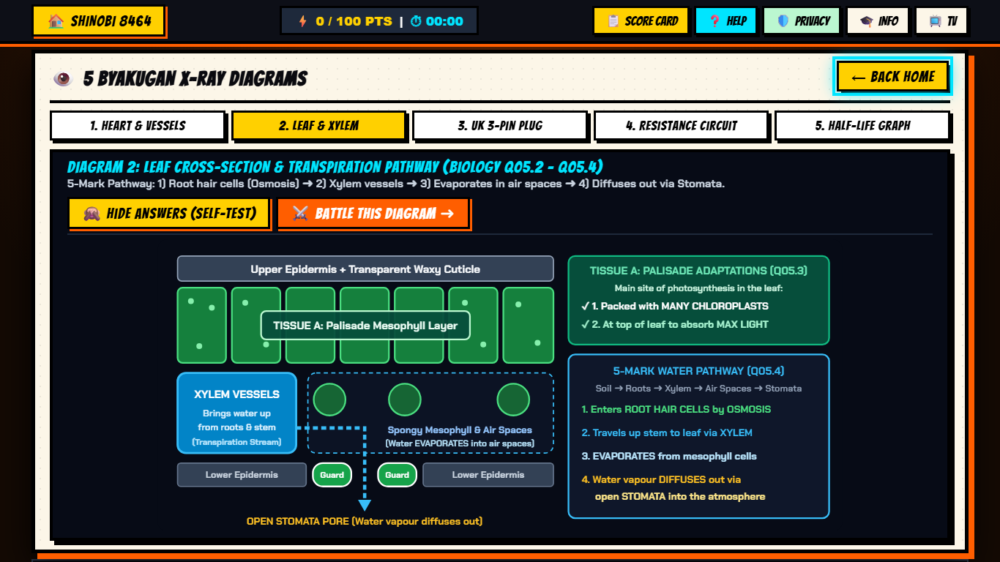
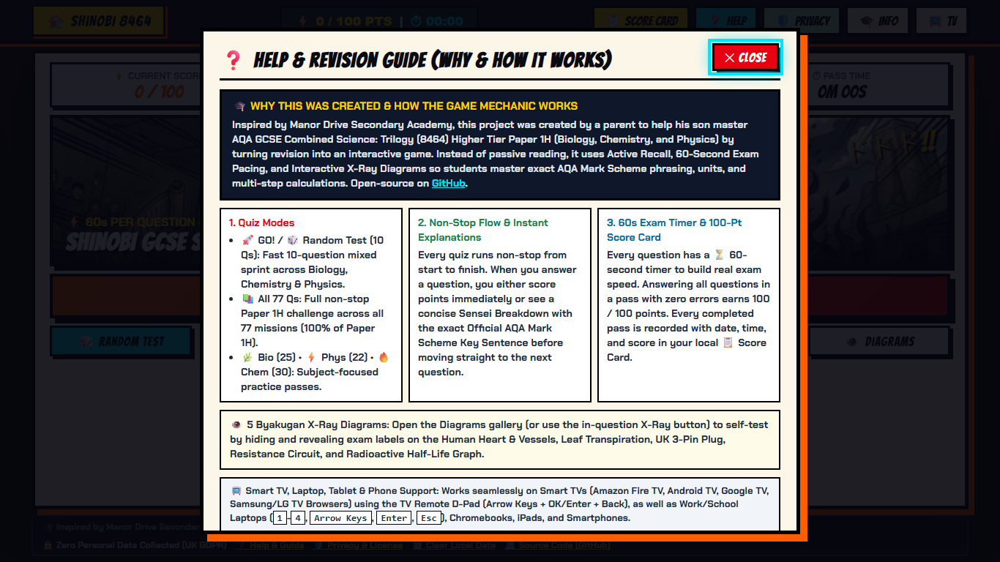
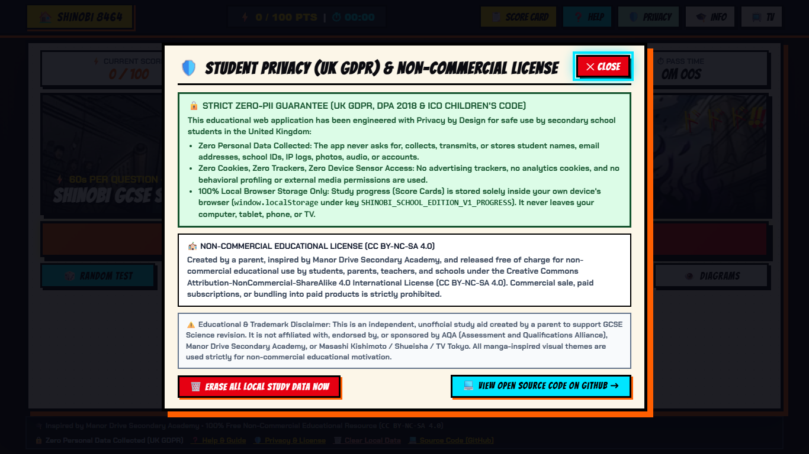
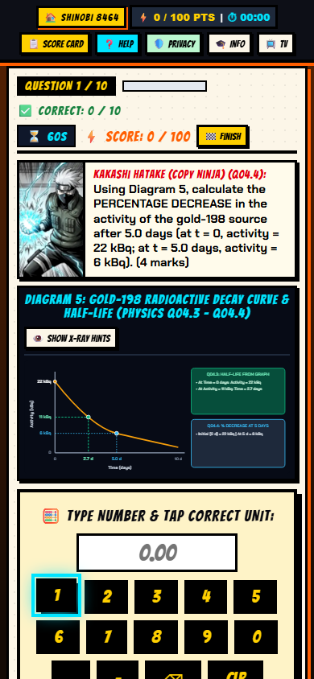

# ⚡ Shinobi Science Manga Academy (GCSE Combined Science 8464 - Paper 1H)

> 🎓 **Inspired by Manor Drive Secondary Academy • Gamified GCSE Science Revision**
> *Created by a parent to help his son studying at **Manor Drive Secondary Academy** master GCSE Science more effectively by turning revision into an action-packed game - and shared freely on GitHub so students, parents, and teachers everywhere can use it too.*

- 🌐 **Play Online (Instant Browser Launch - No Login Required):** [https://mkegorode.github.io/gcse-science-shinobi-academy/](https://mkegorode.github.io/gcse-science-shinobi-academy/)
- 💻 **Source Code Repository:** [https://github.com/MkeGorode/gcse-science-shinobi-academy](https://github.com/MkeGorode/gcse-science-shinobi-academy)
- 📺 **Multi-Screen & Smart TV Ready:** Adapted for **Work & School Laptops** (`1366x768`, `1536x864`, `1920x1080`), **Smart TVs** (Amazon Fire TV, Android TV, Google TV with D-Pad Remote + optional Smartphone TV Controller), Tablets, and Smartphones.
- 💚 **Cost & License:** **100% Free** for non-commercial educational use (`CC BY-NC-SA 4.0`). No ads, no subscriptions, no paywalls.
- 🔒 **Student Data Privacy (UK GDPR & ICO Children's Code):** **Strict Zero-PII.** Zero personal data is collected, transmitted, or stored. No accounts, no names, no emails, no cookies, no analytics, and no device media permissions.

---

## 📸 Screenshots & Multi-Screen Preview

### 1. Welcome & Mission Briefing Start Screen
Every session opens with a clear briefing showing the dedication (*Inspired by Manor Drive Secondary Academy*), the **100% Free** guarantee, and the **Strict Zero Personal Data** notice:

### 2. Work Laptop & School Chromebook Dashboard (`1366x768` / `1920x1080`)
Responsive layout tailored for standard school and work laptops (`1366x768`, `1536x864`, `1920x1080`), desktop monitors, tablets, smartphones, and classroom whiteboards, featuring a one-click **`🚀 GO! (START QUIZ) ➜`** launch button:

### 3. Interactive Battle Card + Byakugan X-Ray Diagram (`60s Timer`)
Split-screen exam battle view with live **60-second countdown timer (`⏳ 60s`)**, **Byakugan X-Ray Diagram** hints, and official **AQA Mark Scheme** multi-step points:

### 4. 5 Interactive Byakugan X-Ray Diagrams Gallery
Students can self-test by hiding and revealing exam labels across 5 core Paper 1H diagrams (Human Heart & Vessels, Leaf Cross-Section & Transpiration, UK 3-Pin Plug, Resistance Circuit, and Radioactive Half-Life Graph):

### 5. Built-In English Help & Revision Guide (`❓ Help`)
In-app British English guide explaining why the tool was created, the quiz modes, the 60-second pacing mechanic, and the 100-point Score Card system:

### 6. Built-In Student Privacy (UK GDPR) & License Notice (`🛡️ Privacy`)
Transparent privacy guarantee for teachers, parents, and school Data Protection Officers (DPOs), including a one-click **"🗑️ Erase All Local Study Data Now"** button:

### 7. Smartphone & Tablet Standalone Mode (`390x844`)
Works out of the box on mobile phones and iPads in 100% standalone touch mode:

---

## 🧠 Why This Tool Was Built & How It Works (Pedagogical Design)

This project was created by a parent to help his son at **Manor Drive Secondary Academy** master **AQA GCSE Combined Science: Trilogy (8464) Higher Tier Paper 1H** through active, game-based practice rather than passive textbook reading.

### Key Revision Mechanics:
- **🚀 One-Click `GO!` / Random Test (10 Qs):** Launches a fast 10-question mixed sprint across Biology, Chemistry, and Physics for daily revision.
- **📚 All 77 Qs & Subject Filters:** Complete a full non-stop Paper 1H pass (`77 missions` covering 100% of all 86 exam sub-questions), or focus on a specific subject:
  - **🌿 Biology Paper 1H (25 Missions):** Cell Biology, Microscopy & Magnification, Stem Cells, Osmosis Required Practical, Heart & Blood Vessels, Vaccines & Clinical Trials, Leaf Structure & Transpiration, Photosynthesis (`1/d²`).
  - **⚡ Physics Paper 1H (22 Missions):** Energy Stores & Renewables, Specific Heat Capacity Required Practical, Thermal Insulation, I-V Characteristics & Resistance Circuits, UK 3-Pin Plug & Mains Electricity, Density & Gravitational Energy Storage, Radioactive Decay & Half-Life (`kBq`).
  - **🔥 Chemistry Paper 1H (30 Missions):** Atomic Structure & Ions, Group 7 Halogens, Covalent & Ionic Bonding, Metals & Alloys, Percentage by Mass (`Mr`), Concentration (`g/dm³`) & pH Scale, Electrolysis of Aqueous Solutions & Molten Aluminium Oxide, Bond Energy (`kJ/mol`), Crucible Stoichiometry & Reaction Profiles.
- **⏳ 60-Second Exam Pacing Timer:** Every question (and every multi-step sub-question) gets a fresh **60-second countdown** to build real exam speed and confidence, automatically pausing when Help, Privacy, or Score Card modals are open.
- **💡 Non-Stop Flow & Instant Sensei Breakdown:** Every quiz runs non-stop from the first question to the final Score Card. If a student selects an incorrect option or runs out of time, the Sensei card immediately displays a step-by-step scientific breakdown and the exact **Official AQA Mark Scheme Key Sentence** before moving straight to the next question.
- **📋 Local Score Card History (100 Points Max):** Every completed pass is scored from **0 to 100 points** (`Math.round((correct / total) * 100)`) and saved with the date, time, mode, and duration in the local Score Card table, while the active score resets to `0` for the next pass.

---

## 🔒 Strict Student Data Privacy & UK GDPR / Safeguarding Compliance

This project has been audited against the **UK GDPR**, the **Data Protection Act 2018**, and the **ICO Age Appropriate Design Code (Children's Code)** for safe deployment in UK secondary schools:

| Privacy & Safeguarding Requirement | Implementation in Public School Edition |
| :--- | :--- |
| **Personal Identifiable Information (PII)** | **Zero collected.** No student names, emails, logins, passwords, school IDs, or profile photos exist anywhere in the app. |
| **Cookies & Analytics Trackers** | **Zero.** No Google Analytics, no Meta pixels, no advertising SDKs, and no tracking cookies. |
| **Device Sensor / Media Permissions** | **Zero.** Does not request or access any audio, video, geolocation, or contact permissions. |
| **External Database / Cloud Uploads** | **Zero.** Nothing is ever uploaded to any external database or server. |
| **Default Network Activity** | **100% Standalone Local Mode.** The app runs entirely inside the student's browser memory without connecting to external brokers by default. |
| **Study Progress Storage (`localStorage`)** | Stored strictly locally on the user's own device under `SHINOBI_SCHOOL_EDITION_V1_PROGRESS`. Can be wiped in one click via the **`🗑️ Clear Local Data`** button. |

---

## 🖥️ Supported Devices & Smart TV Mode (Laptops, Tablets, Phones & Smart TVs)

- **📺 Smart TVs (Amazon Fire TV, Android TV, Google TV, Samsung/LG Web Browsers & Classroom Displays):**
  - Open `https://mkegorode.github.io/gcse-science-shinobi-academy/` in the TV browser (such as Amazon Silk or TV Bro) or append `?tv=1` for dedicated `960x540` 10-foot TV UI scaling.
  - **Full TV Remote D-Pad Support:** Navigate every button, diagram tab, calculation numpad, and answer card using the **TV Remote Directional Pad (`Up`, `Down`, `Left`, `Right`), `OK / Select / Enter`**, and **`Back`** buttons (with high-visibility cyan focus rings).
  - **Optional Smartphone TV Controller (`📺 TV`):** Click **`📺 TV`** on the TV to generate a random one-time 6-digit session code, then connect a smartphone as a tactile wireless gamepad for the TV screen.
- **💻 Work & School Laptops / Desktops:** Windows, macOS, Linux, and ChromeOS (`1366x768`, `1536x864`, `1920x1080` and higher). Supports mouse, touchpad, and keyboard shortcuts (`1`-`4` to select answers, `Arrow Keys` + `Enter` to navigate, `Esc` to close modals).
- **📱 Tablets & Smartphones:** iPad, Android tablets, iPhone, and Android phones in 100% standalone touch mode.
- **📦 Self-Contained Single File (`index.html`):** Because all 77 missions, 5 SVG vector diagrams, manga illustrations, and the quiz engine are compiled into a single self-contained [`index.html`](index.html) file, school IT departments can also download [`index.html`](index.html) and host it directly on an internal school intranet, SharePoint, or Moodle/Google Classroom with zero backend infrastructure required.

---

## 📜 License & Disclaimers

- **License:** Released under the [Creative Commons Attribution-NonCommercial-ShareAlike 4.0 International License (`CC BY-NC-SA 4.0`)](LICENSE.md). Free for non-commercial use by students, parents, teachers, and schools.
- **Disclaimer:** Inspired by **Manor Drive Secondary Academy**. This is an independent, unofficial parent-created educational tool and is not affiliated with, endorsed by, or sponsored by AQA, Manor Drive Secondary Academy, or Masashi Kishimoto / Shueisha.
